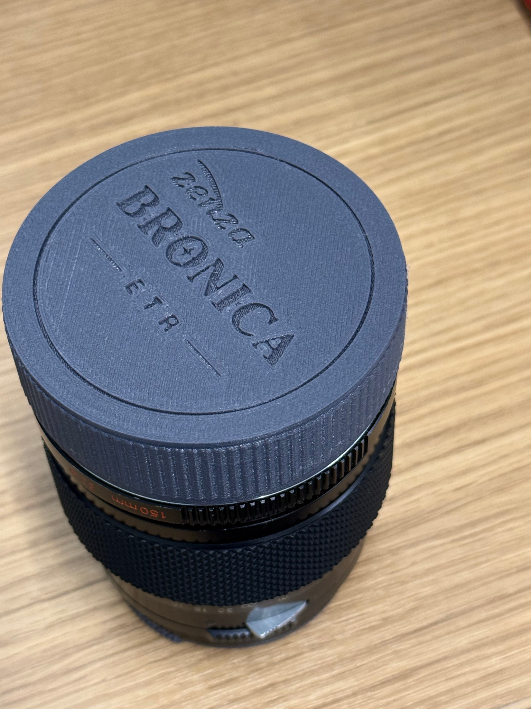
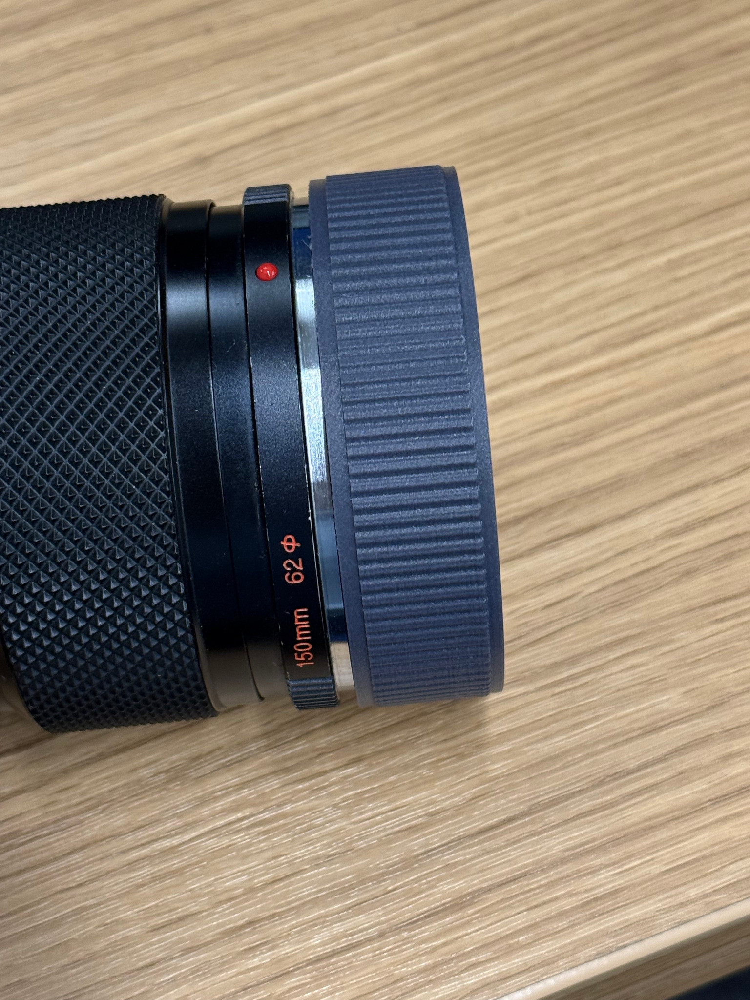
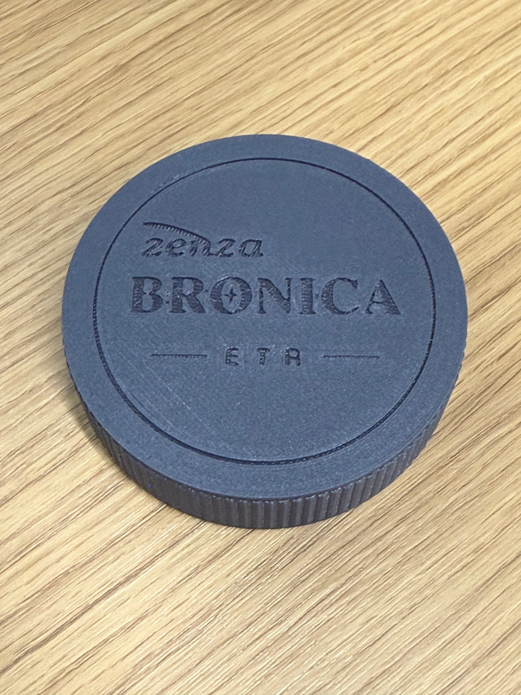
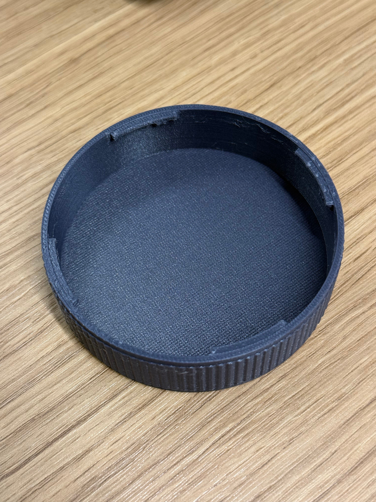

# Zenza Bronica ETR — 3D-Printable Rear Lens Cap

**Free, printable twist-lock rear lens cap** for Bronica ETR-family lenses. Four bayonet retaining lips, **L-shaped twist stops** (to prevent over-rotation), fine vertical grip ribs, and an engraved *zenza BRONICA / ETR*-style face.

> **Fit confirmation:** The repository owner successfully printed and installed the **STANDARD** version on a Bronica ETR **150 mm** lens, shown below. The **SLIGHTLY LOOSE** variant is newly generated and has **not** yet been independently fit-tested. Individual printer calibration and lens variants may differ. This is an unofficial, independently designed accessory, **not an OEM drawing**.



| Installed (side view) | Front, engraved face | Inside, L-shaped retaining lips |
|---|---|---|
|  |  |  |

## Download / choose a fit

| File | Fit | Status |
|---|---|---|
| [`Bronica_ETR_Rear_Cap_STANDARD.stl`](models/Bronica_ETR_Rear_Cap_STANDARD.stl) | Original standard fit | **Tested by maker on ETR 150 mm** |
| [`Bronica_ETR_Rear_Cap_SLIGHTLY_LOOSE.stl`](models/Bronica_ETR_Rear_Cap_SLIGHTLY_LOOSE.stl) | +0.30 mm on bore and lip-tip diameters (+0.15 mm radial clearance) | **Not yet tested** |
| [`Bronica_ETR_Standard_Test_Ring.stl`](models/Bronica_ETR_Standard_Test_Ring.stl) | Short test ring using standard bayonet | Optional fit check |
| [`Bronica_ETR_Slightly_Loose_Test_Ring.stl`](models/Bronica_ETR_Slightly_Loose_Test_Ring.stl) | Short test ring using slightly-loose bayonet | Recommended before printing loose full cap |

The **slightly loose** model changes only radial clearance; stop locations, axial dimensions, engraved logo, and outer grip are unchanged. The wall remains thick enough for typical FDM printing.

### Main dimensions (mm)

| Dimension | STANDARD | SLIGHTLY LOOSE |
|---|---:|---:|
| Maximum exterior diameter, including grip | 82.54 | 82.54 |
| Full cap height | 21.95 | 21.95 |
| Bore diameter (CAD design) | 78.00 | 78.30 |
| Retaining lip minimum internal diameter (CAD design) | 74.00 | 74.30 |
| Bayonet lips | 4 × 31° | 4 × 31° |
| Twist-stop barrier | 4 × 5° | 4 × 5° |
| Engraving depth | 0.68 | 0.68 |

**Note:** These are the dimensions of the independently constructed CAD, not factory measurements of Bronica hardware. The measured fit of STANDARD is a practical print test, not a mechanical tolerance certification.

## Printing

Suggested starting point: **0.4 mm nozzle**, **0.12–0.16 mm layer height** for sharper lettering (0.20 mm also works for structure), **4 walls**, **15–20% infill**, PETG or PLA. The example photos are an actual print, not a render.

- Place the **closed, engraved face flat on the build plate**, with the open bayonet side pointing up.
- Try **without supports** first. The engraved characters may contain short bridge spans; use a clean build surface and calibrated first layer.
- If fit is uncertain, print the appropriate **test ring** before the full cap.
- Before using on a valuable lens, remove all strings and debris, align the four bayonet entry gaps, and rotate gently. **Never force the cap** if it rubs, jams, or touches any lens linkage pins or glass.

## Source / customization

The editable OpenSCAD design is in [`source/Bronica_ETR_Rear_Cap.scad`](source/Bronica_ETR_Rear_Cap.scad). Keep the two accompanying `.svg` files in the same directory; the engraved branding is vector geometry, not a required installed font.

You can select `fit = "standard"` or `fit = "slightly_loose"` at the top of the source. For example:

```bash
openscad -o models/my-standard.stl -D 'fit="standard"' source/Bronica_ETR_Rear_Cap.scad
openscad -o models/my-loose.stl -D 'fit="slightly_loose"' source/Bronica_ETR_Rear_Cap.scad
openscad -o models/my-loose-test-ring.stl -D 'fit="slightly_loose"' -D 'part="test_ring"' source/Bronica_ETR_Rear_Cap.scad
```

For matching existing prints, **use the checked-in STANDARD STL** as the known-good baseline. STL meshes have been checked for watertightness but only STANDARD has a reported real-lens fit test.

## Contributions

Feedback, printed makes, measurements, issues, and pull requests are welcome. Please include your lens focal length/model, printer, material, and whether the cap locks fully without excessive force. Fit data for 75 mm and other ETR lenses would be especially helpful.

## License and trademarks

Original 3D geometry, parametric source, documentation, and project photos: **Creative Commons Attribution–ShareAlike 4.0 International (CC BY-SA 4.0)** — see [`LICENSE.md`](LICENSE.md). You may copy, remix, and print the design, including commercially, with attribution and the same license for adapted material.

**ZENZA BRONICA / BRONICA** are historical brand names / marks of their respective rights holders. The decorative mark here is a Bronica-style recreation, not an official logo file; **the project's CC license does not grant trademark rights**. This independent fan-made accessory is not affiliated with or endorsed by Bronica or any successor brand owner.
